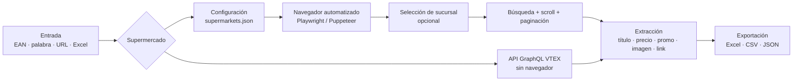

# 🛒 Price Intelligence: Supermercados Argentina

**Monitoreo automatizado de precios y productos de supermercados online en Argentina.**
Releva títulos, precios de lista, promociones, precios de referencia, imágenes y links de **Vea,
Carrefour, Disco y Dino / Super MaMi**. Se puede buscar por **código EAN**, palabra clave,
categoría o **sucursal**, y los datos salen listos en **Excel, CSV o JSON** para análisis
competitivo, armado de listas de precios o seguimiento de la inflación por producto.


---

## 📌 ¿Qué problema resuelve?

Comparar precios entre supermercados a mano es lento y se desactualiza enseguida: cada cadena
tiene su propio sitio, sus promociones y, en algunos casos, **precios distintos según la
sucursal**. Este proyecto automatiza ese relevamiento:

- ✅ **Multi-supermercado**: un mismo flujo para varias cadenas.
- ✅ **Búsqueda por EAN**: se carga un Excel con códigos de barras y se obtiene el precio de cada producto en cada súper.
- ✅ **Precios por sucursal**: elige provincia y tienda antes de relevar (Vea).
- ✅ **Promociones y precio de referencia**: no solo el precio de lista.
- ✅ **Salida lista para usar**: Excel, CSV o JSON con fecha en el nombre del archivo, para comparar en el tiempo.
- ✅ **Configurable sin programar**: para agregar un supermercado alcanza con sumar sus selectores a un archivo JSON.

### Casos de uso
- **Comercios y distribuidores**: ver a qué precio venden la competencia y las grandes cadenas.
- **Armado de listas de precios**: tomar el precio de góndola como referencia para fijar el precio al público.
- **Seguimiento de inflación por canasta**: correr la misma lista de EAN cada semana y comparar.
- **Catálogos**: descargar nombres, imágenes y links de productos de una categoría.

---

## ⚙️ ¿Cómo funciona?



### 1. Entrada
El usuario indica **qué buscar**: una palabra (`yerba`), un código EAN (`7790070012050`), la URL
de una categoría o **un archivo `.xlsx` con una lista de EAN** en la primera columna. Los scripts
principales lo preguntan por consola con un menú.

### 2. Elección del supermercado y su configuración
Cada supermercado tiene un archivo JSON con:
- la **URL de búsqueda**, con un marcador `{SEARCH}` que se reemplaza por lo que se busca;
- los **selectores** (XPath/CSS) de cada dato: título, precio, precio promocional, precio de referencia, imagen, link, marca;
- cuántas **páginas** recorrer;
- el **formato del Excel** de salida: nombre del archivo, hoja y columnas.

Así, el mismo motor (`scrap.js`) sirve para cualquier súper: solo cambia la configuración.

### 3. Obtención de los datos: tres estrategias
| Estrategia | Cómo trabaja | Cuándo conviene |
|---|---|---|
| **Navegador automatizado** (Playwright / Puppeteer) | Abre Chromium, carga la búsqueda, hace **scroll automático** para que carguen todos los productos y avanza por las **páginas** con el botón "siguiente". | Sitios que cargan los productos con JavaScript (Vea, Disco, Dino). |
| **API GraphQL de VTEX** | Consulta directamente el servicio que usa la propia web de Carrefour y recibe los productos en JSON, **sin abrir un navegador**. | Mucho volumen y máxima velocidad (Carrefour). |
| **Grabación de Chrome DevTools** | Se graba una vez el recorrido en Chrome (DevTools → Recorder) y `reproductor_vea.js` lo repite paso a paso con Puppeteer. | Flujos con varios clics, como elegir método de entrega, provincia y tienda. |

### 4. Selección de sucursal (opcional)
En Vea los precios cambian según la tienda. Antes de relevar, el scraper:
1. abre "Seleccioná el método de entrega";
2. elige **"Retirar en una tienda"**;
3. selecciona **provincia** y **tienda** (por ejemplo, Córdoba → Vea Av. Juan B. Justo);
4. confirma y recién después recorre las categorías.

### 5. Extracción
De cada producto se obtienen, cuando el sitio los muestra: **título, precio, precio promocional,
precio de referencia (por kg o por litro), imagen, link, marca y categoría**.
Algunas versiones guardan también el texto visible de la página para revisarlo después.

### 6. Exportación
Los resultados se guardan en `<super>_data_<fecha>.xlsx` (o `.csv` / `.json`). Como la fecha va
en el nombre, se pueden juntar varias corridas y ver **cómo evoluciona cada precio**.
Hay ejemplos reales en las carpetas `resultados/` de cada versión.

---

## 🏪 Cobertura

| Supermercado | Búsqueda | Por EAN | Por sucursal | Estrategia | Última versión |
|---|:-:|:-:|:-:|---|---|
| [**Vea**](Vea/) | ✅ | ✅ | ✅ | Playwright · Puppeteer · DevTools · Python | 03/2025 |
| [**Carrefour**](Carrefour/) | ✅ | — | — | API GraphQL VTEX · Jupyter · Playwright | 02/2025 |
| [**Disco**](Disco/) | ✅ | — | — | Playwright con paginación | 10/2024 |
| [**Dino / Super MaMi**](Dino/) | ✅ | ✅ | — | Playwright · scraper genérico | 11/2024 |
| [**Multi-súper**](_Varios%20supermercados/) | ✅ | ✅ | — | Motor genérico configurable por JSON | 11/2024 |

> Vea, Disco y Carrefour usan la plataforma **VTEX**, así que gran parte de los selectores y de la
> lógica sirve para otras cadenas VTEX, como Jumbo.

---

## 📁 Estructura del repositorio

El repositorio está organizado **por supermercado**. Dentro de cada uno, las versiones van de la
más vieja (`v1`) a la más nueva; la más reciente lleva ⭐ en su README y **ULTIMA** en el nombre
de la carpeta. Así queda a la vista cómo evolucionó cada scraper.

```
├── Vea/
│   ├── 1_Sin login ni sucursal/      v1 → v6
│   └── 2_Con sucursal (sin login)/   v1 → v2 ⭐
├── Carrefour/                        v1 → v3 ⭐
├── Disco/                            v1 ⭐
├── Dino/                             v1 → v3 ⭐
├── Super MaMi/                       material de referencia
└── _Varios supermercados/            menús y motor genérico v1 → v5
```

Cada carpeta tiene su propio **README** con el detalle de cada versión y cómo correrla.
En cada versión:
- los scripts están en la raíz;
- `resultados/` tiene los Excel, CSV y capturas generados;
- `docs/` tiene la documentación (Word/PDF).

### 🔐 Login y sucursales
Los scrapers están separados según lo que necesitan:
- **Sin login ni sucursal**: Carrefour, Disco, Dino, `_Varios supermercados` y `Vea/1_Sin login ni sucursal`.
- **Con selección de sucursal** (provincia + tienda, sin cuenta): `Vea/2_Con sucursal (sin login)`.
- **Con inicio de sesión**: `Vea/3_Con login`. **No está en este repositorio**: tiene email,
  contraseña y cookies, así que queda en el `.gitignore` y solo existe en local.

---

## 🚀 Inicio rápido

### Opción A: motor multi-súper (Node.js)
```bash
cd "_Varios supermercados/v4_2024-11-15_scraper generico configurable (JS)"
npm install
npx playwright install chromium
node menu.js
```
1. Elegí el supermercado.
2. Escribí una palabra, un EAN, una URL **o la ruta de un Excel con EAN** (por ejemplo, `resultados/ean_canasta.xlsx`).
3. El resultado queda en `<super>_data.xlsx`.

### Opción B: Carrefour por API (Python, sin navegador)
```bash
cd "Carrefour/v3_2025-02-21_proyecto E-commerce - ULTIMA"
pip install requests
python carre.py
```
Pide el producto y la cantidad de páginas, y genera `productos_<busqueda>.csv`.

### Opción C: Vea por sucursal (Python)
```bash
cd "Vea/2_Con sucursal (sin login)/v1_2025-03-17_python relevamiento"
pip install playwright
playwright install chromium
python "relevamiento (1).py"
```
En `main()` se configuran `provincia` y `tienda`.

### Requisitos generales
- **Node.js 18+** para los scrapers JS.
- **Python 3.9+** para los scrapers Python.
- Conexión a internet y Chromium (lo instala Playwright).

---

## ➕ Agregar un supermercado nuevo

1. Abrí la web del súper, buscá un producto e inspeccioná (F12) el título, el precio y la imagen.
2. Copiá una entrada de `supermarkets.json` y cambiá `baseURL` y los `...Locator`.
3. Corré `node menu.js` y elegí el súper nuevo.

No hace falta tocar el código del motor.

---

## ⚠️ Aviso

Proyecto con fines **educativos y de relevamiento de precios públicos**. Antes de usarlo, revisá
los términos de uso de cada sitio, evitá hacer muchas solicitudes seguidas y no lo uses para
recolectar datos personales. Los selectores pueden dejar de funcionar si los sitios cambian su
diseño.
